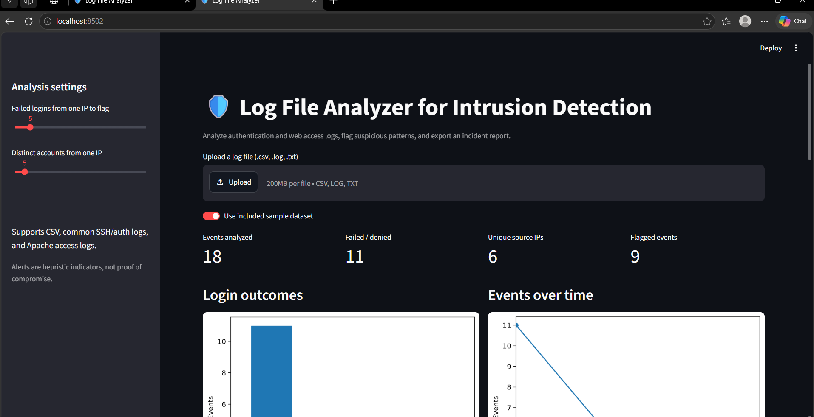
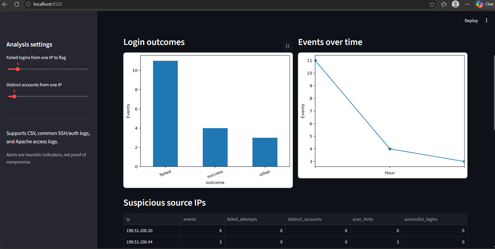
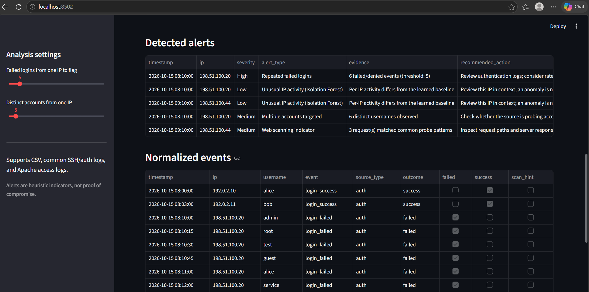
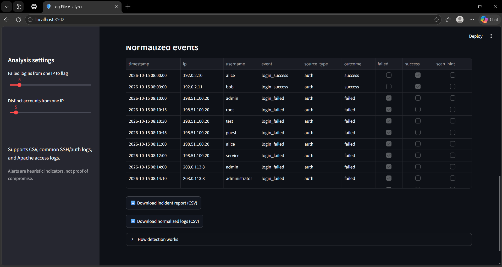

# 🛡️ Log File Analyzer for Intrusion Detection

A Python-based security log analysis dashboard that identifies suspicious login activity, repeated authentication failures, web scanning indicators, and unusual patterns using **Pandas, Scikit-learn, and Streamlit**.

## 📸 Screenshots

### 1. Dashboard Overview


### 2. Analytics and Suspicious Source IPs


### 3. Detected Security Alerts


### 4. Export Incident Reports


## ✨ Features

- Upload security logs in CSV, LOG, and TXT formats.
- Analyze authentication and web access events.
- Detect repeated failed logins and multiple accounts targeted from one IP.
- Identify common web scanning indicators.
- Apply Isolation Forest anomaly detection.
- Visualize login outcomes, event trends, suspicious IPs, and detected alerts.
- Export incident reports and normalized logs as CSV files.
- Adjust detection thresholds using the dashboard sidebar.

## 🧰 Tech Stack

- **Language:** Python
- **Data analysis:** Pandas
- **Machine learning:** Scikit-learn, Isolation Forest
- **Dashboard:** Streamlit
- **Visualization:** Matplotlib
- **Testing:** Pytest

## 🚀 Run Locally

### 1. Clone the repository

```bash
git clone https://github.com/tulsidounekarr/log-file-analyzer-intrusion-detection.git
cd log-file-analyzer-intrusion-detection
```

### 2. Create and activate a virtual environment

Windows PowerShell:

```powershell
python -m venv .venv
.\.venv\Scripts\Activate.ps1
```

### 3. Install dependencies

```bash
pip install -r requirements.txt
```

### 4. Launch the dashboard

```bash
streamlit run app.py
```

Open the local URL shown in your terminal, usually `http://localhost:8501`.

## 🧪 Run Tests

```bash
pytest
```

## 📂 Project Structure

```text
log-file-analyzer-intrusion-detection/
├── app.py
├── analyzer.py
├── requirements.txt
├── data/
│   ├── README.txt
│   └── sample_security_logs.csv
├── reports/
│   └── README.txt
├── screenshots/
├── tests/
│   └── test_analyzer.py
├── START_HERE.txt
└── README.md
```

## ⚠️ Important Notes

- The included sample dataset is synthetic and intended for demonstration.
- Detection alerts are indicators for investigation, not proof of compromise.
- Use only logs you are authorized to analyze.
- Incident reports are generated through the dashboard and can be downloaded as CSV files.

## 🎯 Project Objective

To demonstrate practical skills in Python programming, security log analysis, data processing, anomaly detection, and interactive dashboard development.

## 👨‍💻 Author

**Tulsi Dounekar**

[GitHub Repository](https://github.com/tulsidounekarr/log-file-analyzer-intrusion-detection)
